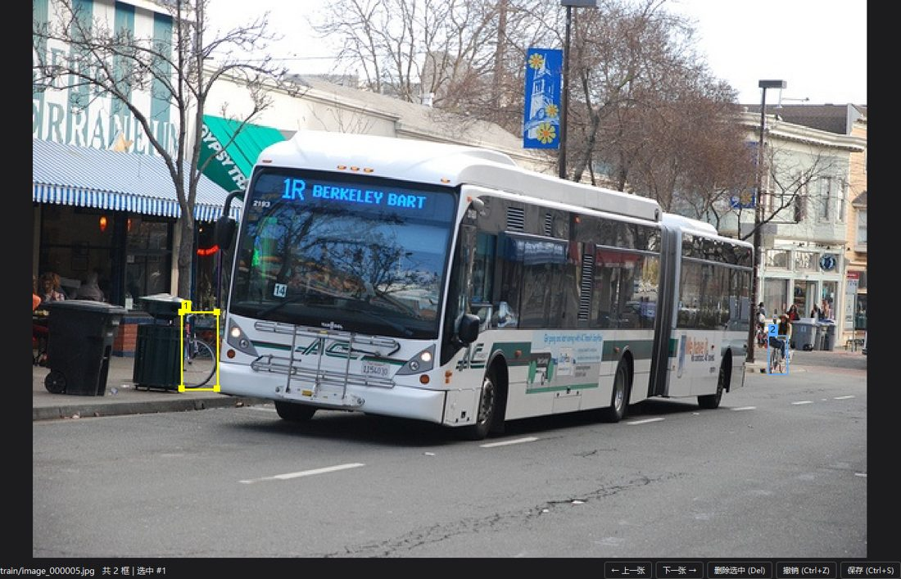
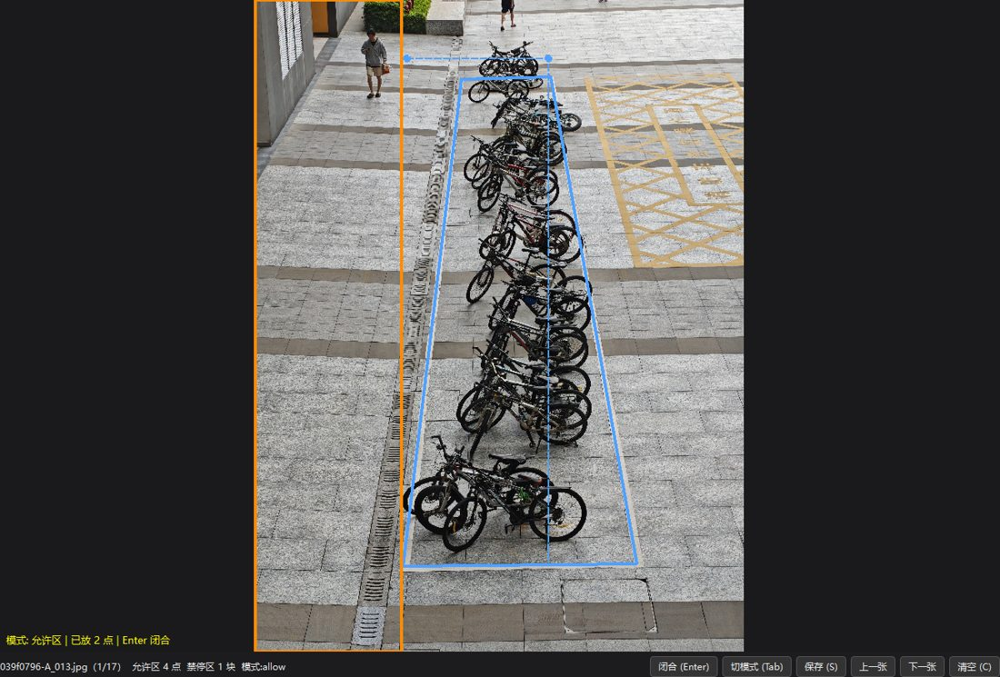

# 校园自行车违停检测 · 阶段一实验报告

> 2026-11-22　｜　YOLO11 + SAM2 + 几何判定

## 一、项目概述

目标：从图片中判断自行车是否违规停放，最终接入校园视频监控。违规口径三条——停在划线外、停在通道上、车头压线。

本阶段的核心判断：越界是一个几何问题，不是分类问题。模型只负责找出自行车和它的轮廓，是否越界由「车」与「标定区域」的关系决定。这个判断决定了整个技术路线——不做多类别训练，而是检测 + 掩膜 + 多边形判定。

- 输入：单张图片（后续为视频帧）
- 输出：每辆车的判定结果（合规 / 压线 / 出界 / 占道）与可视化图、CSV
- 约束：数据量小（个位数场地、十几到上百张图），无法支撑从零训练

## 二、数据与数据治理

本阶段投入最大、回报也最大的部分。原始数据存在两个致命问题，直接决定模型不可用。

### 2.1 原始数据体检

| 问题 | 实测结果 | 影响 |
|---|---|---|
| 图片重复 | 553 个文件里只有 153 张唯一图，495 个是 MD5 相同的副本（最多一张复制 20 份） | 有效样本只有名义的 27% |
| 训练/验证泄漏 | 54 组重复图同时出现在 train 与 val | 验证指标虚高，无法反映真实泛化 |
| 标注不可用 | 2156 个标注框中，仅 1.9% 与自行车贴合；85.5% 与任何检出车辆都不重叠 | 按原标注训练等于学错目标 |

原标注的典型表现：一辆车被画成覆盖半张图的大框，或者框落在行人、汽车、空地上。对比图显示，原标注 11 个框把整条街铺满，重标后 9 个框分别落在自行车上。

### 2.2 处理流程

- 按内容 MD5 去重，把 553 个文件收敛为 153 张唯一图，train/val 按哈希重新划分，彻底消除泄漏
- 用 COCO 预训练 YOLO11x 重新自动标注（553 张耗时 44 秒），得到 2548 个候选框
- 人工精修：153 张中 35 张有实质改动，393 框删到 335 框（-15%），15 张整图清空作为负样本
- 空标注文件予以保留，用于教模型「这里没有车」

### 2.3 最终数据集

| 数据集 | 规模 | 内容 | 用途 |
|---|---|---|---|
| dataset_v2 | 153 张（112 训练 / 41 验证），335 框 | 街景自行车，人工精修后的单类标注 | 通用检测训练 |
| dataset_school | 17 张，3072×4096，147 车 + 17 停车区多边形 | 校园实拍，含停车区标定 | 场景验证与判定 |

*图 1　自研标注精修工具：点选、拖动、删除、自动保存，按置信度上色*

## 三、方法

### 3.1 检测

YOLO11s，从 COCO 预训练权重微调。不使用从零训练：目标类别 bicycle 本就在 COCO 中，微调只需让模型适配本校场景的视角与光照。

### 3.2 掩膜

用检测框作为提示，交给 SAM2（hiera-tiny）做实例分割，得到每辆车的像素级轮廓。SAM2 不需要重新训练，也不需要任何多边形标注。

### 3.3 判定

取掩膜最底部 2% 高度的条带作为「接地点」近似，计算这些像素落在允许区内的比例，按比例分档：≥0.9 合规，0.1~0.9 压线，≤0.1 出界；车身掩膜与禁停区重叠超过 5% 判占道。

用掩膜而不是框的原因：框是轴对齐矩形，斜靠的自行车会把大片背景算进车身，导致压线判定失真；掩膜只覆盖车辆像素本身。

### 3.4 区域标定

越界与否依赖「哪里允许停车」，这是场地属性、不是像素属性，因此由人工标定：在工具里沿地面划线内点选多边形，按图存储，支持单场景多机位。

*图 2　停车区标定工具：蓝色为允许区，橙色为禁停区*

### 3.5 场景识别与区域迁移

新图先判断是否属于已标定场地：SIFT 特征匹配 + RANSAC 估计单应矩阵，内点数作为判据；判定为同场地后，用同一单应矩阵把标定好的多边形变换到新视角。迁移后沿边搜索路面白线做吸附，把多边形拉到实际划线上。

## 四、实验与结果

### 4.1 训练实验

| 实验 | 配置 | 结果 | 结论 |
|---|---|---|---|
| v1 | lr0=0.01（默认） | 第 30 轮 mAP 从 0.39 崩到 0，loss 由 2.0 跳到 3.8，cls_loss 跳到 1900+ | 小数据集用默认学习率必然发散 |
| v2 | lr0=0.002，关闭 AMP | 稳定但每轮 30 秒 | AMP 必须开，否则慢 10 倍 |
| v3 | lr0=0.002，AMP，150 轮上限 | 最佳出现在第 6 轮，53 轮触发早停；bicycle 单类 mAP50 = 0.762 | 数据量不足，模型几乎没学到东西 |
| demo | 同一配置，20 轮 | 38 秒完成，mAP50 = 0.406 | 验证流程可复现 |

*图 3　训练诊断：第 28 轮后验证损失陡升、mAP 归零，属于数值发散而非过拟合*

*图 4　20 轮后的验证集预测：自行车框住，但 parking_area 被当成小框乱猜（青框）*

parking_area 类 mAP 为 0：训练样本仅 14 个，且该区域面积占半张图，2 类检测无法同时学好。这条结论直接导致把区域改为人工标定、不做模型学习。

### 4.2 框规则 vs 掩膜规则

| 规则 | 判定为违停 | 说明 |
|---|---|---|
| 框规则（车身在区外 >2%） | 72 辆 | 框含背景，斜靠车大量误报 |
| 掩膜规则（接地点跨线） | 32 辆 | 只看到车轮实际落点 |
| 差异 | 40 辆 | 减少 56% 的误报 |

*图 5　掩膜判定结果：绿=合规，黄=压线，红=出界，蓝线为允许区*

### 4.3 判定结果分布

在 17 张校园实拍（全部为规范停放）上运行，理论上正确输出应为 0 辆违停，因此报警数即为误报数。

| 轮次 | 合规 | 压线 | 出界 | 占道 | 合计违停 |
|---|---|---|---|---|---|
| 初版区域（车排外接框） | 230 | 21 | 11 | 0 | 32 |
| 重画区域后 | 236 | 13 | 13 | 0 | 26 |

26 / 262 辆 ≈ 10% 误报率，主因是区域边界与地面白线不重合，而不是检测错误。这也说明：本阶段精度瓶颈在标定，不在模型。

### 4.4 场景识别

| 测试集 | 单应内点数 | 判定结果 |
|---|---|---|
| 同场地 17 张 | 56 ~ 4001 | 17/17 正确识别 |
| 异场地 41 张（街景） | 5 ~ 34 | 41/41 正确拒绝 |

取阈值「内点 ≥ 45 且占比 ≥ 0.8%」，两类之间留有安全间隔。

### 4.5 区域迁移与吸附

| 环节 | 误差 | 说明 |
|---|---|---|
| 单应估计本身 | 0.4% 图宽 | 全特征 vs 仅地面特征，角点差极小，说明估计稳定 |
| 跨视角迁移 | 5 ~ 10% 图宽 | 参考多边形自身误差 + 视角变化被放大 |
| 白线吸附后 | ≈1% 图宽 | 沿边搜索白线，位移 34~68 px 修正了偏差 |

*图 6　橙色=仅单应迁移（偏移约 5%），绿色=迁移后再吸附到白线*

### 4.6 性能

| 环节 | 耗时 | 备注 |
|---|---|---|
| YOLO 检测 | 48 ms | 1280 输入，RTX 5070 |
| SAM2 编码 | 84 ms | 每帧一次 |
| SAM2 逐车分割 | 9 ms/辆 | 21 辆共 193 ms |
| 全量流水线 | 325 ms | 约 3.1 fps |
| 仅对区外目标分割 | 150 ms | 约 6.6 fps，可用于视频 |

### 4.7 工程修复（阶段末）

- 修复掩膜流水线 RGB/BGR 通道错位：YOLO 收 BGR、SAM 收 RGB，尺寸与坐标统一
- 区域配置语义明确化：显式空 allow 表示「未标定」，缺失键才继承场景默认
- 接地点条带改为按目标掩膜高度计算，不再使用整图高度
- 掩膜面积不足或质量不合格时记为「无法判定」，不混入合规/违停统计
- 未标定图片只做检测、不执行分割，输出「未标定」而非报错
- 新增 13 项 CPU 回归测试（合成掩膜 + 替代模型），覆盖类别、通道、区域继承、阈值边界

## 五、难点与解决

| 难点 | 现象 | 原因 | 处理 |
|---|---|---|---|
| 数据重复与泄漏 | 553 张实际只有 153 张唯一图，54 组跨 train/val | 数据来源拼接、按文件而非内容划分 | MD5 去重 + 按哈希重划分 |
| 标注不可用 | 85.5% 的框与任何车辆不重叠 | 标注工具/流程不规范，或由模型批量生成后未校验 | 预训练模型重标 + 人工精修，保留负样本 |
| 越界无法用分类学 | 多类别训练时区域类 mAP=0 | 「是否越界」是关系而非外观特征 | 改为检测 + 几何判定，区域人工标定 |
| 区域无法从像素推断 | 不标区域时系统无法判断 | 允许停放范围是场地先验，非视觉属性 | 工具标定一次长期复用；匹配失败则只检测不判定 |
| 框的适配性差 | 同一批图，框规则比掩膜规则多报 40 辆 | 轴对齐矩形包含大量背景 | 引入 SAM2 掩膜 + 接地点判定 |
| 训练发散 | 第 30 轮 mAP 归零、损失跳一个数量级 | 小数据集沿用默认 lr0=0.01 | lr0 降到 0.002；写诊断脚本自动判定发散/过拟合/欠拟合 |
| 跨角度区域漂移 | 迁移后的多边形偏移 5~10% 图宽 | 单应只能精确映射一个平面，且参考多边形自身有误差 | 迁移给粗位置 + 白线吸附给精边界，约 95% 贴合 |
| 小样本指标不可信 | 3 张验证图上 mAP 波动 ±0.1 | 验证集太小，单次结果噪声大 | 以误报率为主指标，配合人工看图；后续用 5 折或留出集 |

## 六、结论

- 判定链路完整跑通：检测 → 掩膜 → 接地点 → 几何判定 → 可视化与统计
- 掩膜方案相比框方案减少 56% 误报，是本阶段最有效的技术选择
- 当前误报率约 10%，瓶颈在区域标定精度，不在模型
- 模型侧受限于数据量（唯一图 153 张、校园场景 17 张），继续训练收益有限
- 未验证项：召回率——目前没有任何真实违停样本，这是最大盲区

## 七、下一步

- P1（1~2 周）：采集 20~30 张真实违停样本，建立召回率基线；补负样本（海报/屏幕中的自行车、地面影子）
- P2（1~2 月）：积累 200+ 张区域多边形标注，训练 yolo11-seg 双类模型，实现区域自动识别
- P3（2~3 月）：接入视频，抽帧 + 跟踪（ByteTrack）去重，停留时长过滤，报警推送
- P4（3~6 月）：SAM 蒸馏为分割学生模型，ONNX/TensorRT 部署，去掉 SAM 依赖

## 八、附录

### 8.1 环境

- Python 3.12（conda 环境 sam2），torch 2.11.0+cu128，RTX 5070 12 GB
- ultralytics 8.4（独立安装于项目内 yolo-lib，不改动 conda 环境）
- SAM2.1 hiera-tiny 权重与仓库复用本机已有安装

### 8.2 关键命令

数据体检：python relabel/check_dataset.py --data dataset_school/data.yaml

训练：python relabel/train.py --data dataset_school/data.yaml --weights relabel/weights/yolo11s.pt --imgsz 1280 --epochs 150 --batch 8 --lr0 0.002 --workers 0 --amp --name school_v4

训练诊断：python relabel/diagnose_training.py --run runs/school_v3

判定：python relabel/violation_mask.py --source <图片目录> --scenes dataset_school/scenes.json --scene school_row

### 8.3 代码与数据

- 仓库：github.com/hmy-AI-bite/bike-violation（main 分支）
- 数据、权重、训练产物均不入库（.gitignore 控制），仓库仅约 3 MB

## 九、PPT 大纲（12 页）

| 页 | 标题 | 要点 | 配图 |
|---|---|---|---|
| 1 | 封面 | 校园自行车违停检测｜阶段一汇报 | — |
| 2 | 问题定义 | 三种违停：划线外／通道上／车头压线；当前做图片，下一步做视频 | 违停示意图 |
| 3 | 核心思路 | 越界是几何问题，不是分类问题；模型只找车，区域由人标定 | 流程图 |
| 4 | 数据体量 | 553 文件 → 153 唯一图；删除 495 个重复，修复 54 组泄漏 | 去重前后对比 |
| 5 | 标注质量 | 原标注仅 1.9% 可用；重标 + 人工精修 393→335 框 | 前后对比图 |
| 6 | 技术路线 | YOLO11 检测 + SAM2 掩膜 + 接地点几何判定 | 架构图 |
| 7 | 关键对比 | 框规则 72 辆 vs 掩膜 32 辆，误报减少 56% | 图 5 |
| 8 | 区域标定 | 工具点选、按图存储；跨视角用单应迁移 + 白线吸附 | 图 2 + 图 6 |
| 9 | 实验记录 | lr0=0.01 第 30 轮发散；降到 0.002 后稳定；小样本下 mAP 不可信 | 图 3 |
| 10 | 当前精度 | 误报约 10%；召回率未测（无真实违停样本） | 结果统计表 |
| 11 | 难点总结 | 数据脏、区域靠人、掩膜会粘车、小样本指标噪声大 | 难点表 |
| 12 | 下一步 | P1 补违停样本 → P2 区域分割模型 → P3 视频 → P4 部署 | 路线图 |
