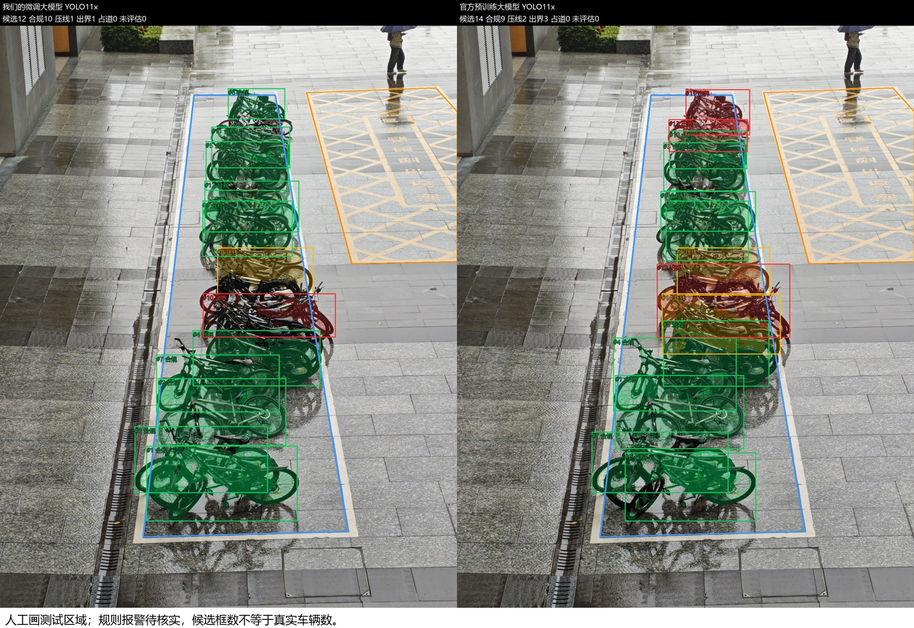
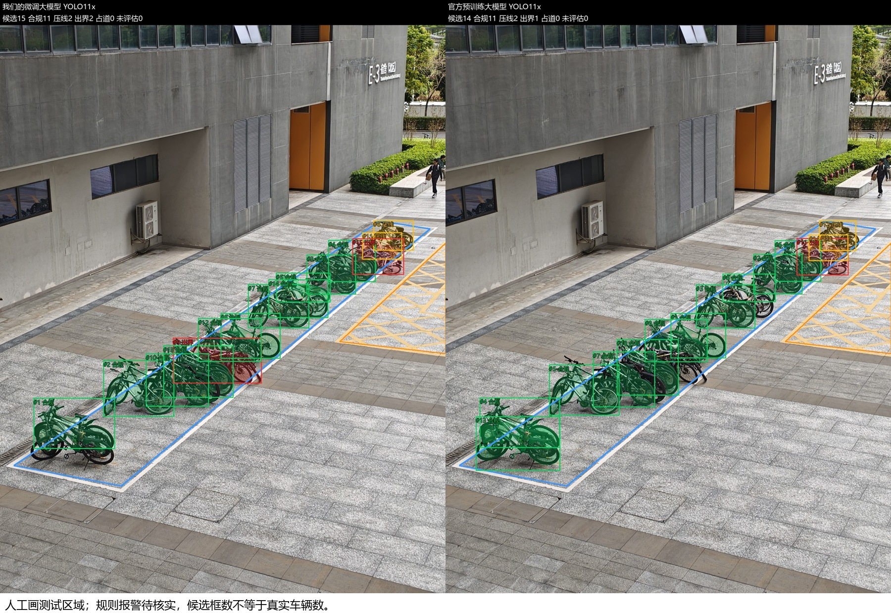
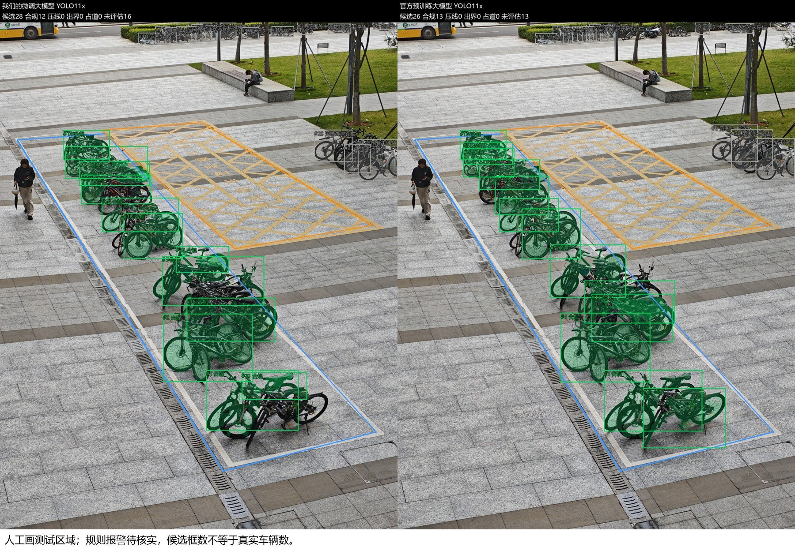

# 自行车违停检测工作总结 2026 年 11 月 25 日

今天完成新数据核验、两套模型对比、YOLO11x 微调及 YOLO11x 与 SAM2 同驻显存测试。大模型微调可以在 RTX 5070 上运行，新模型避免了旧微调小模型在所选图片上的严重漏检；目前尚无独立人工标注证明其优于官方大模型。密集车辆粘连和轻微侧向越线仍影响违停判定。

## 数据核验

收到 66 张原图，约 430 MiB。全部能解码，文件大小与分享清单一致；按 SHA256 去重后为 60 张，其中 11 张独立图片与旧学校数据相同，实际新增 49 张。当前未提供自行车框、停车区或违停真值标注。

| 分组 | 原图数量 |
|---|---:|
| 点位 A 角度 1 | 47 |
| 点位 A 角度 2 | 7 |
| 点位 A 角度 3 | 8 |
| 其他场景 | 4 |

这批图片仅用于开发阶段测试，没有用于微调或最佳权重选择。已经反复查看并用于定位问题，后续应另留未查看的数据用于最终测试。旧学校数据还存在训练集与验证集的完全重复图片，其历史指标不能作为独立泛化验证。

## 模型对比

旧微调模型 `school_v3/best.pt` 的初始权重是 YOLO11s，并非本次对比的 YOLO11x。其训练日志共 53 轮，第 37 轮开始出现 NaN；这说明该次训练出现异常，但不能据此断言所保存的最佳权重损坏。

先用两套模型对全部 60 张独立图片做自行车检测；随后选取代表图片完成 SAM2 分割与几何判定。以下三张不与旧学校数据完全重复。所有对比均使用 YOLO 输入 1280、置信度 0.35、NMS IoU 0.45、最多 200 个目标。

| 图片 | 旧微调 YOLO11s 候选框 | 官方 YOLO11x 候选框 | 新微调 YOLO11x 候选框 |
|---|---:|---:|---:|
| 雨天 A_1_038 | 4 | 14 | 12 |
| 斜侧 A_2_007 | 3 | 14 | 15 |
| 角度 3 A_3_008 | 9 | 26 | 28 |

候选框不等于真实车辆数量；更多框可能来自重复检测、背景车辆或误检。角度 3 的违停判定只评估前景主停车区：新微调大模型评估 12 个框、官方大模型评估 13 个框，其他区域不作违停判定。

新对比图左侧为微调后的 YOLO11x，右侧为官方原始 YOLO11x；两侧均接入 SAM2.1 Tiny，使用同样的人工测试区域和几何阈值。







旧小模型与官方大模型的对比：[雨天](images/2026-11-25_small_rain.jpg)、[斜侧](images/2026-11-25_small_side.jpg)、[角度 3](images/2026-11-25_small_angle3.jpg)。

## 大模型微调

训练使用既有 `dataset_v2`：112 张训练图、259 个框，41 张验证图、76 个框。检查未发现图片损坏、标注格式错误或文件完全重复；格式检查不等于标注语义已全部正确。

| 设置 | 本次取值 |
|---|---|
| 初始模型 | 官方 YOLO11x |
| 显卡 | RTX 5070，约 12 GB 显存 |
| 输入与批次 | 1280，每批 4 张 |
| 优化器与初始学习率 | AdamW，0.0001 |
| 冻结层 | 前 10 层 |
| 训练轮数 | 最多 40，连续 12 轮验证指标不提升时停止 |
| 实际训练 | 13 轮，最佳权重为第 1 轮 |
| 数值检查 | 每轮检查损失、指标及模型参数，未出现 NaN/Inf |
| PyTorch 显存峰值 | 分配约 7287 MiB，预留约 8034 MiB |

最佳权重在上述 41 张验证图上的 Precision 为 0.844、Recall 为 0.842、mAP50 为 0.871、mAP50-95 为 0.689。这些指标不代表新学校测试图片上的违停准确率，也没有建立相对于原始大模型的量化提升。

本地权重为 `runs/bike11x_v1/weights/best.pt`；原始模型和旧模型均保留。连续训练没有超过首轮最佳表现，当前不宜以增加轮数代替数据和标注检查。

## SAM2 与违停判定

SAM2 在密集车群中能分割部分轮廓，但会混入邻车或漏掉车轮。它不能自动补回当前框提示流程中 YOLO 漏检的车辆，模型质量得分也不是违停概率。

斜侧 A_2_007 中有倒下的自行车，其车轮可见地伸出白线；两套大模型流程均在该位置输出出界报警，属于人工观察支持的有效案例。其他报警中仍有粘车和边界近似问题，未作逐辆独立真值评分。

雨天末端有轻微侧向越线漏报。现有规则只比较掩膜最低 2% 条带与允许区的关系，最低条带不一定对应真实接地点，也无法覆盖所有车身侧向伸出情况。人工绘制的测试区域同样需要复核。

局部对比：[雨天近端](images/2026-11-25_sam_near.jpg)、[雨天远端](images/2026-11-25_sam_far.jpg)、[斜侧中间](images/2026-11-25_sam_middle.jpg)。紫色为算法使用的最低条带近似。

## 显存实测

两个模型分别测试，每次让一套 YOLO11x 与 SAM2.1 Tiny 同驻 GPU。YOLO 单图输入 1280，SAM2 输入图最大 1400×1900，按检测框逐辆分割。

| 同驻配置 | PyTorch 分配峰值 | PyTorch 预留峰值 | 整卡占用采样峰值 |
|---|---:|---:|---:|
| 微调 YOLO11x 与 SAM2 Tiny | 967 MiB | 1324 MiB | 2467 MiB |
| 官方 YOLO11x 与 SAM2 Tiny | 967 MiB | 1240 MiB | 2386 MiB |

整卡采样包含桌面等其他进程，采样可能错过瞬时峰值。当前配置均完成三张图片推理，没有显存不足；这不是更大 SAM2 或多图并行的容量承诺。

## 下一步

1. 明确违停标准：以车轮接地点、地面占用，还是车身任何部分越线为准。
2. 人工精标约 20 张开发评估图，覆盖遮挡、雨天、倒车和轻微越线；另保留未查看的最终测试数据。
3. 逐辆统计检测漏检与重复框、分割粘车、几何判定错误，优先处理占比最高的一类。
4. 每次变更继续输出微调模型与官方模型的相同参数左右对比，避免只按候选框数量判断效果。

## 复现与文件

实验脚本位于 `experiments/20261125`，统计证据见 [2026-11-25_evidence.json](2026-11-25_evidence.json)。原始图片、数据标签、模型权重、完整运行日志与掩膜保存在本地，不随 Git 上传。

在项目根目录的 PowerShell 中运行，需已有本机 `sam2` 环境、`yolo-lib`、官方 YOLO11x 权重及 SAM2 仓库和 Tiny 权重。路径由仓库根目录的 `config.py`、本地 `.env` 或环境变量提供，详见 README。

```powershell
$env:YOLO_CONFIG_DIR = "$PWD\relabel\cfg"
$env:MPLCONFIGDIR = "$PWD\relabel\cfg\mpl"
$py = (Get-Command python).Source

# 开始新训练前换一个未使用的 --name；本次权重保存在 bike11x_v1。
& $py experiments/20261125/train_yolo11x.py --epochs 40 --name bike11x_v2 --imgsz 1280 --batch 4

# 以下默认检查本次 bike11x_v1，测试图片从 incoming 下读取。
& $py experiments/20261125/prepare_detections.py
& $py experiments/20261125/run_comparison.py
& $py experiments/20261125/measure_pipeline.py
```

对比脚本只做测试；重复执行会重写对应本地对比产物，不修改原图或权重。CPU 规则回归使用 `tools/test_violation_rules.py`，不加载真实模型。
